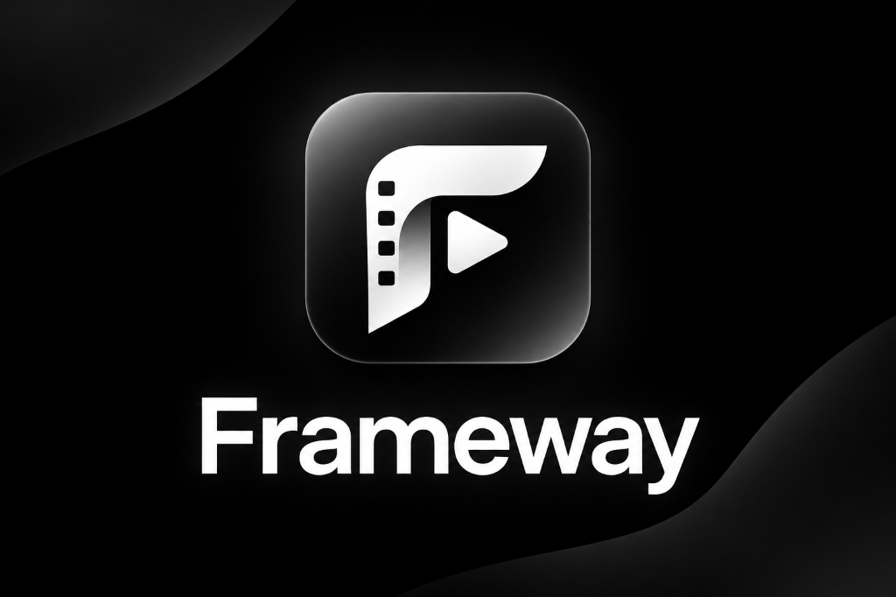

# Frameway

npm install && npm run dev   (Chrome or Edge recommended)

Open "Ready" at the top right (Setup & verification). Every part reports a live status with a fix if something is wrong.
- Script: Gemini (free key from aistudio.google.com/apikey; optional Pro) or an on-device model (WebLLM, 1-2 GB once, needs WebGPU).
- Voice: Kokoro-82M in the browser (~90 MB once); falls back to your browser's voice.
- Visuals: built-in animated scenes, or real AI video via ComfyUI (https://comfy.org/download):
  1. Install and open ComfyUI Desktop. The page shows "running" the moment it starts.
  2. Settings > Server Config > "Enable CORS header" = *, restart.
  3. Open a text-to-video template (LTX or Wan), let it download models, run it once.
  4. Press Connect (or upload a workflow you saved from ComfyUI; no editing needed), then Run test to render one real clip.
Settings are saved in this browser. Download/upload a config file under Backup (API key excluded unless you switch it on).
